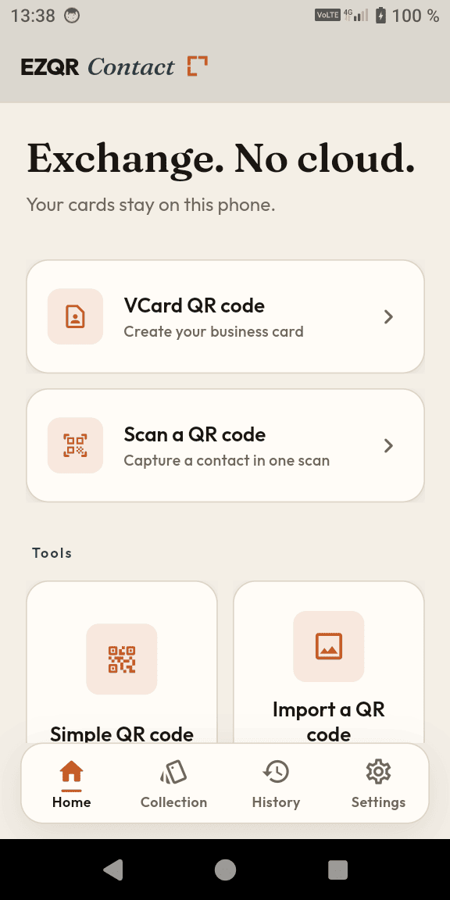
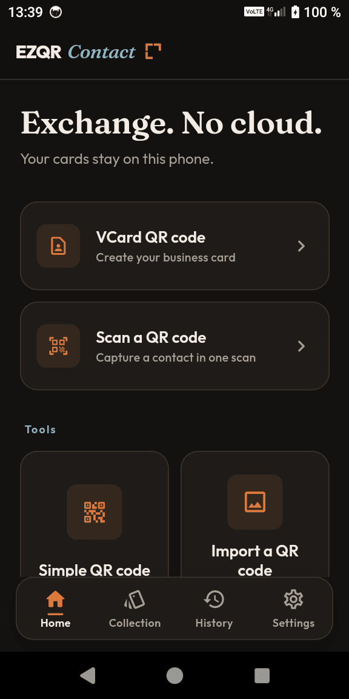
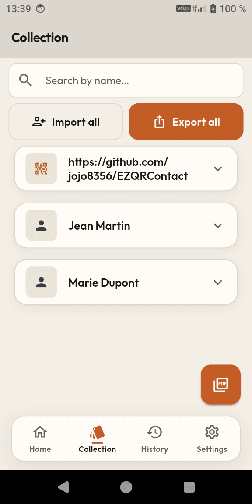
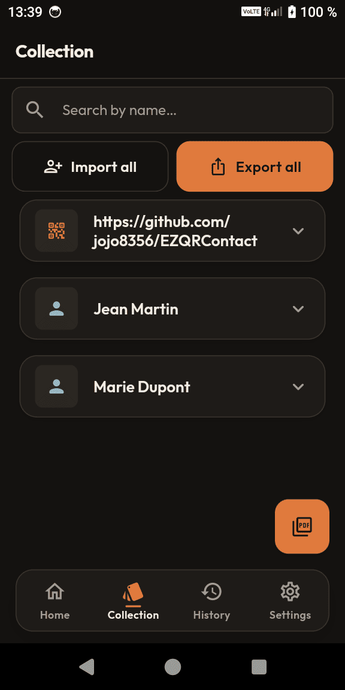
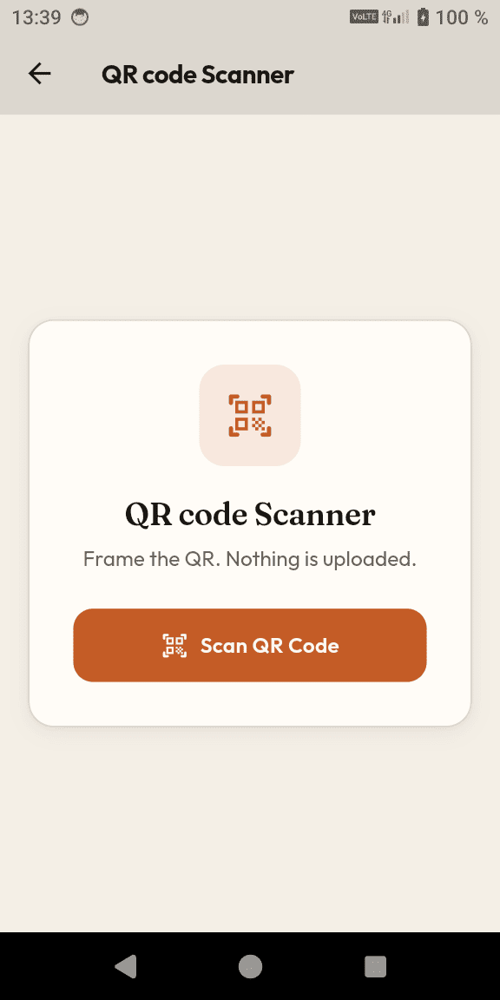

# EZQRContact

> Swap professional contacts in person. No cloud, no account, no subscription.

[](LICENSE)
[](https://flutter.dev)
[](https://github.com/jojo8356/EZQRContact/actions/workflows/ci.yml)
[](https://github.com/jojo8356/EZQRContact/commits/main)

EZQRContact is a local-first Android and iOS app. You encode your vCard in a
QR code. Someone scans it with their camera (or this app) and your contact
lands in their address book. Cards stay on the phone. The only optional
network call is a small photo host so a QR with a portrait stays scannable
(see [PRIVACY.md](PRIVACY.md)).

Built for sales reps, exhibitors, recruiters, and freelancers who swap
dozens of cards a day at fairs and meetups.

**User guide:** [English](docs/help/user-guide.md) · [Français](docs/help/guide-utilisateur.md)

## Screenshots

| Light | Dark |
|---|---|
|  |  |
|  |  |



Refresh the set with `./scripts/capture_screenshots.sh` on a phone or emulator.

## Why

Paper cards get thrown away. Cloud card apps (Blinq, HiHello, Popl) work, but
they need an account, a SaaS, and a monthly fee.

EZQRContact is different:

- **MIT.** Fork it, audit it, ship your own build.
- **Local first.** Cards live in SQLite on the phone. No backend.
- **Local by default.** No account graph. Optional photo host is documented
  in [PRIVACY.md](PRIVACY.md).
- **Native.** Not a PWA. Installs from source or a release APK.
- **Free.** No Pro tier.

## Features

- vCard QR **3.0** (default, works with iOS / Android / Outlook / Google) or **4.0** (Settings)
- Scan with the camera, or decode a screenshot from the gallery (ML Kit then ZXing)
- Profile photo: resized, hosted as a URL when online so the QR stays scannable; skipped when offline
- Visual identity: copper/ink theme, primary color, optional logo, layout templates
- Reciprocal swap: offer your card back after you scan someone
- Collection: search, import all phone contacts (skip name dupes), export a flat zip (`contacts.vcf` + text QRs)
- Long-press a card **more than 2 seconds** to multi-select, then delete or export the checked ones
- French and English UI, light and dark mode
- Contacts permission is optional: the in-app card is always saved; the OS address book is updated only if access is granted

## Stack

| Area | What |
|---|---|
| App | Flutter `>=3.47`, Dart 3.13, Android API 24+, iOS 12+ |
| Data | [Drift](https://pub.dev/packages/drift) on sqflite (`qr_app.db`), SharedPreferences |
| QR | [qr_flutter](https://pub.dev/packages/qr_flutter), [ai_barcode_scanner](https://pub.dev/packages/ai_barcode_scanner), [zxing2](https://pub.dev/packages/zxing2) |
| Files | [archive](https://pub.dev/packages/archive), [file_saver](https://pub.dev/packages/file_saver) |
| Contacts | [flutter_contacts](https://pub.dev/packages/flutter_contacts), [permission_handler](https://pub.dev/packages/permission_handler) |
| UI | ENCRE tokens (`lib/theme`), Outfit + Fraunces, [lucide_flutter](https://pub.dev/packages/lucide_flutter) |
| Lint | [very_good_analysis](https://pub.dev/packages/very_good_analysis) plus house rules (no ternary, pure `build` returns) |

## Install / Quickstart

**Requirements:** Flutter SDK `>=3.47.0`, Android `compileSdk = 37`, Xcode 15+ for iOS.

```bash
git clone https://github.com/jojo8356/EZQRContact.git
cd EZQRContact
flutter pub get
dart run build_runner build --delete-conflicting-outputs
flutter test
flutter run
```

`lib/data/db/database.g.dart` is generated by Drift. Without `build_runner`,
analyze / test / run fail.

Release APKs: see [RELEASING.md](RELEASING.md). Helpers `build.sh` and `prod.sh`
live at the repo root; read them before running.

## Project structure

```
lib/
  main.dart          # MaterialApp, routes, onboarding gate
  theme/             # ENCRE tokens, typography, ThemeData
  pages/             # Home, Collection, History, Settings, scanners, generators
  components/        # Cards, navbar, buttons, select bar
  data/db/           # Drift schema (VCard, SimpleQR)
  providers/         # Theme, language, vCard 4 / reciprocal flags
  tools/             # vCard, contacts, import/export zip, QR decode
docs/
  help/              # End-user tutorial (EN + FR)
  direction-artistique.md
  screenshots/
```

## Docs

| Doc | For |
|---|---|
| [User guide](docs/help/user-guide.md) | People using the app |
| [CONTRIBUTING.md](CONTRIBUTING.md) | People changing the code |
| [PRIVACY.md](PRIVACY.md) | What leaves the phone |
| [SECURITY.md](SECURITY.md) | Vulnerability reports |
| [CODE_OF_CONDUCT.md](CODE_OF_CONDUCT.md) | Community |
| [CHANGELOG.md](CHANGELOG.md) | What shipped |
| [RELEASING.md](RELEASING.md) | Tag → APK → Play / App Store |
| [Art direction](docs/direction-artistique.md) | ENCRE visual system |

## Contributing

PRs welcome. Setup, Conventional Commits, tests, and house rules:
[CONTRIBUTING.md](CONTRIBUTING.md).

Looking for a first task? [Good First Issues](https://github.com/jojo8356/EZQRContact/contribute).

## License

[MIT](LICENSE) © Johan Polsinelli
